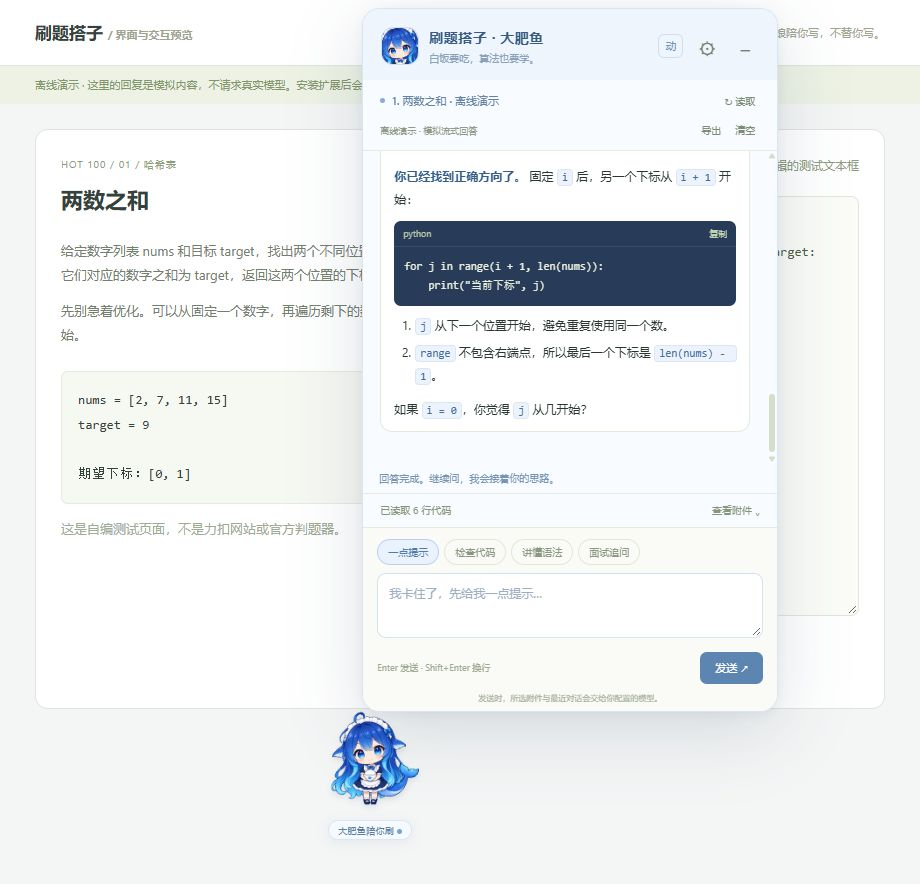

# 刷题搭子 · Leet Pet Coach

住在力扣页面的「大肥鱼」算法老师。你在力扣写代码、运行和提交，它读取题目与当前代码，使用你配置的模型逐步讲解。适合 Python 入门、Hot100 练习与面试复习。



## 安装

1. 下载仓库 ZIP 并解压，或使用 Git 克隆仓库。
2. Chrome 打开 `chrome://extensions`；Edge 打开 `edge://extensions`。
3. 开启「开发者模式」，点击「加载已解压的扩展程序」，选择仓库里的 **extension** 文件夹（包含 manifest.json）。
4. 打开力扣中国站或国际站的题目页，刷新页面，点击右下角大肥鱼。
5. 点击齿轮，填写供应商、API 地址、模型 ID 和自己的 API Key，点击「保存并授权接口」。
6. 点击「保存并测试连接」，回到题目页，点击「读取」核对代码，再发送问题。

使用扩展无需 npm install、构建或自建后端。更新文件后，在扩展管理页重新加载扩展，并刷新力扣页面。

## 功能

- 读取题目与完整编辑器代码；无法读取完整代码时明确提示，并支持手动粘贴。
- 一点提示、检查代码、讲懂语法、面试追问四种教学入口。
- 流式回答、停止生成、分题保存聊天、Markdown 导出、代码复制。
- 支持行内代码、代码块、加粗、列表、引用及安全链接，保留代码中的真实引号。
- 聊天展开时可直接拖动大肥鱼，或拖动窗口标题栏；位置自动保存。
- 透明待机 GIF、眨眼、呼吸及思考/开心状态；可暂停动画，遵循系统减少动态效果设置。

## 模型配置

支持 DeepSeek、OpenAI、Gemini 的 OpenAI 兼容接口、Anthropic Messages、Ollama 以及自定义 OpenAI Chat Completions 兼容服务。

DeepSeek 预设使用 `https://api.deepseek.com` 和 `deepseek-flash`。其他服务请填写账号实际可用的模型 ID。Ollama 默认地址为 `http://localhost:11434/v1`，填写本机安装的模型名称，密钥可留空。自定义远程服务要求 HTTPS，本机服务允许 HTTP。

也可在设置页选择自己的配置文本，导入其中明确标注 DeepSeek 的唯一密钥；仓库不包含个人配置或真实密钥。模型请求使用你自己的 API 账户，与 ChatGPT / Codex 订阅及聊天记录独立。

## 数据与权限

- 默认仅访问力扣中国站和国际站；保存配置时为实际 API 域名申请访问权限。
- API Key 保存在当前浏览器扩展本地存储，未加密、不云同步；后台限制内容脚本访问密钥。
- 发送问题时，选中的题目、代码、补充报错与最近聊天直接发送给所配置的模型服务商。仅点击「读取」不会调用模型。
- 测试连接仅发送固定测试文本。不读取力扣 Cookie，也不自动改代码、运行或提交答案。
- 聊天按题保存，最多保留 25 道题的近期消息；重要记录请导出。
- 回复通过安全 DOM 节点渲染，不执行模型生成的 HTML 或 JavaScript。

## 开发与验证

需要 Node.js 22 或更高版本。自动测试无需安装依赖：

```sh
npm test
```

测试覆盖接口请求、流式解析、鉴权隔离、题目历史、编辑器读取、设置保存与富文本渲染。

启动离线界面预览：

```sh
npm run preview
```

打开 `http://127.0.0.1:8767/problems/two-sum/`；设置预览在 `/settings`。预览模拟浏览器扩展 API 和模型回复，请勿填入真实密钥。它用于界面验证，实际页面提取和浏览器域名授权仍需在 Chrome / Edge 安装后验证。AI 检查并非实际执行，运行与判题使用力扣。

扩展运行代码在 `extension/`，测试在 `tests/`，离线演示在 `preview/`。若需重新处理图片素材，先运行 `npm install` 安装 Sharp，然后按需执行 `node prepare-whale-assets.cjs`、`node make-icons.cjs`、`node make-idle-gif.cjs`。生成来源和提示词见 [ART.md](ART.md)。大肥鱼为 AI 生成的同人形象，非 DeepSeek 官方素材，本项目与力扣及模型服务商无隶属关系。
